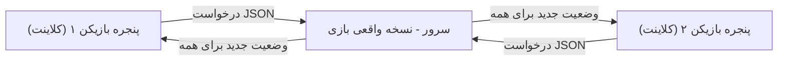
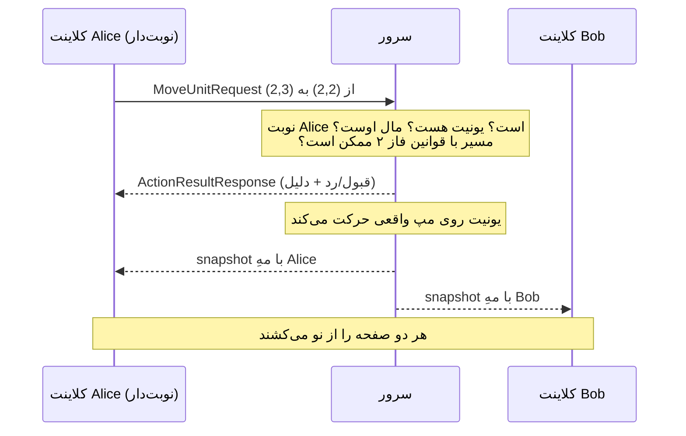

# معماری فاز ۳ به زبان ساده (نسخه فارسی)

<div dir="rtl">

این فایل همان تصمیم‌های `phase3-architecture.md` را توضیح می‌دهد، اما از صفر و با این فرض که تا حالا برنامه‌نویسی شبکه نکرده‌ای. اگر ارزیاب پرسید «این چطور کار می‌کند؟»، جواب‌ها اینجاست.

---

## ۱. مسئله چیست؟

در فاز ۱ و ۲ کل بازی **یک برنامه** بود: کلیک می‌کردی، همان لحظه کد Controller مدل بازی را عوض می‌کرد و صفحه دوباره کشیده می‌شد. همه چیز در یک حافظه بود.

فاز ۳ می‌گوید: چند نفر، روی چند کامپیوتر (یا چند پنجره روی یک کامپیوتر)، باید **یک بازی مشترک** را بازی کنند. یعنی:

- وضعیت بازی (مپ، یونیت‌ها، منابع) باید یک جا نگه‌داری شود، نه در هر پنجره یک نسخه.
- وقتی من یونیتم را حرکت می‌دهم، تو باید همان لحظه ببینی.
- هیچ‌کس نباید بتواند تقلب کند (مثلا با دستکاری برنامه خودش به خودش منابع بدهد).

راه‌حل استاندارد این مسئله «**کلاینت-سرور**» است و داک فاز ۳ هم دقیقا همین را اجبار کرده.

---

## ۲. کلاینت-سرور یعنی چه؟

- **سرور**: یک برنامه جدا که «رئیس» بازی است. تنها نسخه واقعی بازی در حافظه اوست. به این می‌گویند **Single Source of Truth** (تنها منبع حقیقت).
- **کلاینت**: برنامه‌ای که هر بازیکن اجرا می‌کند — همان بازی گرافیکی خودمان. اما دیگر حق ندارد خودش چیزی را تغییر دهد؛ فقط دو کار می‌کند:
  ۱) هر کلیک را به شکل یک «درخواست» برای سرور می‌فرستد («می‌خواهم این یونیت را به فلان خانه ببرم»).
  ۲) هر چه سرور برایش می‌فرستد را روی صفحه می‌کشد.

چرا این‌طوری؟ چون به کلاینت **نمی‌شود اعتماد کرد**. برنامه کلاینت دست بازیکن است؛ می‌تواند تغییرش دهد. ولی سرور دست هیچ بازیکنی نیست، پس هر قانونی (AP کافی؟ نوبت توست؟ یونیت مال توست؟) را **سرور** چک می‌کند. اگر درخواست غلط بود، سرور رد می‌کند و دلیلش را می‌فرستد («It is not your turn») و کلاینت همان جمله را عینا نشان می‌دهد.

در پروژه ما:

- کد سرور: پکیج `Network/Server` (کلاس‌های `GameServer`، `ClientHandler`، `Lobby`، `GameSession`)
- کد کلاینت: پکیج `Network/Client` (کلاس‌های `NetworkManager`، `LobbyWindow`، `MultiplayerSession`، `MultiplayerMenu`)
- پیام‌های بینشان: پکیج `Network/Messages`

</div>



<div dir="rtl">

---

## ۳. سوکت، TCP و UDP یعنی چه؟

**سوکت (Socket)** یعنی «سیم مجازی» بین دو برنامه. جاوا دو نوع اصلی دارد و داک گفته از **هر دو** استفاده کنیم و انتخابمان را توجیه کنیم:

| | TCP | UDP |
|---|---|---|
| شبیه چیست؟ | تماس تلفنی: اول وصل می‌شوی، هرچه بگویی به ترتیب و کامل می‌رسد | کارت‌پستال: می‌اندازی توی صندوق؛ شاید برسد، شاید نه، شاید دیر |
| تضمین رسیدن؟ | بله، با حفظ ترتیب | نه |
| سرعت/هزینه | کمی سنگین‌تر | خیلی سبک |
| در پروژه ما | همه چیزهای مهم: لابی، چت، حرکت، پایان نوبت، وضعیت بازی | فقط heartbeat (پینگ) |

منطق انتخاب ساده است: **اگر گم شدن یک پیام بازی را خراب می‌کند، باید TCP باشد.** گم شدن «پایان نوبت» فاجعه است → TCP. گم شدن یک «پینگ» هیچ اهمیتی ندارد چون دو ثانیه بعد پینگ بعدی می‌رود → UDP.

heartbeat یعنی چه؟ کلاینت هر ۲ ثانیه یک بسته کوچک UDP به سرور می‌فرستد، سرور همان را برمی‌گرداند، کلاینت زمان رفت‌وبرگشت را حساب می‌کند — این همان عدد «ping: 2 ms» بالای لابی است. (کد: نخ `pingLoop` در `NetworkManager` و نخ `heartbeatLoop` در `GameServer`.)

---

## ۴. پیام‌ها: JSON و کلاس Message

دو برنامه که با سوکت حرف می‌زنند فقط می‌توانند **بایت** رد و بدل کنند. باید یک «زبان مشترک» تعریف کنیم. داک گفته این زبان **JSON** باشد — متنی ساده که هر زبان برنامه‌نویسی می‌فهمد:

</div>

```json
{"type":"MoveUnitRequest","fromX":2,"fromY":2,"toX":2,"toY":3,"id":"a1b2...","createdAt":1756400000000}
```

<div dir="rtl">

طراحی ما (که داک هم دقیقا همین الگو را پیشنهاد داده):

- یک کلاس پایه `Message` داریم با سه فیلد مشترک: `type` (این پیام چیست؟)، `id` (شناسه یکتا) و `createdAt` (زمان ساخت). آن دو فیلد آخر را داک برای همه موجودیت‌های داده‌ای اجباری کرده.
- برای **هر نوع** پیام یک زیرکلاس کوچک هست: `JoinLobbyRequest`، `ChatSendRequest`، `MoveUnitRequest`، `EndTurnRequest`، `GameStateBroadcast` و... هر کدام فقط فیلدهای خودش را دارد.
- کلاس `MessageCodec` تبدیل دوطرفه را انجام می‌دهد: `encode` شیء را با کتابخانه **Gson** (مجاز در داک) به یک خط JSON تبدیل می‌کند؛ `decode` اول فیلد `type` را می‌خواند، از روی آن می‌فهمد باید کدام کلاس ساخته شود، و می‌سازد.

نکته نمره‌دار (اصل Open/Closed از SOLID): برای اضافه کردن یک پیام جدید فقط **یک کلاس جدید + یک خط register** لازم است؛ به هیچ کد موجودی دست نمی‌زنیم. هیچ `if/else` طولانی روی نوع پیام وجود ندارد.

هر پیام دقیقا **یک خط** است (JSON فشرده بدون Enter) و پیام‌ها خط‌به‌خط خوانده می‌شوند — این‌طوری گیرنده همیشه می‌داند یک پیام کجا تمام شد.

---

## ۵. نخ (Thread) یعنی چه و چرا این‌قدر مهم است؟

**نخ** یعنی یک خط اجرای مستقل داخل یک برنامه. مشکل: خواندن از سوکت «**بلاک‌کننده**» است — یعنی دستور `readLine()` همان‌جا می‌ایستد تا پیامی برسد، شاید چند دقیقه!

### سمت سرور: یک نخ برای هر کلاینت

سرور باید هم‌زمان به چند کلاینت گوش بدهد. اگر یک نخ داشت، تا وقتی منتظر پیام بازیکن ۱ است، بازیکن ۲ قفل می‌شد. الگوی ما (پیشنهاد خود داک، **thread-per-connection**):

- نخ اصلی سرور در حلقه `ServerSocket.accept()` می‌ایستد؛ هر بار کلاینتی وصل شود، یک **`ClientHandler`** جدید (که خودش یک Thread است) برایش ساخته می‌شود.
- هر `ClientHandler` فقط پیام‌های کلاینتِ خودش را می‌خواند و جواب می‌دهد.

### مشکل race condition و راه‌حل synchronized

حالا چند نخ داریم که همه می‌خواهند به **یک** وضعیت مشترک (لابی، بازی) دست بزنند. اگر دو نخ هم‌زمان بنویسند، داده خراب می‌شود — به این **race condition** می‌گویند و بدترین نوع باگ است چون هر بار تست کنی شاید رخ ندهد.

راه‌حل ما: همه متدهای عمومی `Lobby` و `GameSession` کلمه `synchronized` دارند. یعنی جاوا تضمین می‌کند در هر لحظه فقط **یک نخ** داخل آن شیء باشد؛ بقیه پشت در صف می‌ایستند. چون هر تغییری در بازی فقط از داخل همین متدها ممکن است، کل بازی عملا «تک‌نویسنده» است و race نداریم. لیست شنونده‌های کلاینت هم `CopyOnWriteArrayList` است (نسخه thread-safe لیست).

### سمت کلاینت: EDT را هرگز بلاک نکن

Swing (کتابخانه گرافیکی ما) فقط **یک** نخ برای همه کارهای گرافیکی دارد: **EDT** (Event Dispatch Thread). هر کلیک، هر دکمه، هر رسم صفحه روی همین یک نخ اجرا می‌شود. اگر روی EDT بنشینیم و منتظر پیام سرور بمانیم، **کل پنجره فریز می‌شود** (دقیقا همان چیزی که داک ممنوع کرده).

بنابراین کلاینت دو مسیر جدا دارد (کد: `NetworkManager`):

- **مسیر ارسال**: کلیک → Controller → متد `send` → نوشتن روی سوکت (سریع است، مشکلی ندارد).
- **نخ شنونده (Listener Thread)**: یک نخ جدا که همیشه روی `readLine()` نشسته. وقتی پیامی رسید، آن را decode می‌کند و بعد با **`SwingUtilities.invokeLater(...)`** به EDT می‌گوید «هر وقت بیکار شدی، این آپدیت UI را اجرا کن». یعنی کار شبکه روی نخ شبکه، کار گرافیک روی نخ گرافیک.

این همان الگوی **Observer** هم هست: `LobbyWindow` و `MultiplayerSession` خودشان را به عنوان Listener ثبت می‌کنند و `NetworkManager` هر پیام رسیده را به آن‌ها خبر می‌دهد؛ شبکه اصلا نمی‌داند UI چیست.

---

## ۶. چرا سرور یک «پراسس جدا» است؟

از فاز ۱ همه کد ما از یک متغیر سراسری استفاده می‌کند: `Game.instance` (الگوی Singleton — یعنی «در کل برنامه فقط یک بازی هست»). این در تک‌نفره عالی بود، ولی در فاز ۳ مشکل‌ساز شد:

- سرور باید نسخه **واقعی** بازی را در `Game.instance` نگه دارد.
- کلاینت هم باید نسخه **نمایشی** خودش را در `Game.instance` بگذارد (چون همه کد رندر از همان می‌خواند).

اگر «Host Game» سرور را داخل همان برنامه بازیکن اجرا می‌کرد، این دو نسخه سر یک متغیر دعوا می‌کردند. راه‌حل: وقتی Host می‌کنی، بازی با `ProcessBuilder` یک **JVM جدید** (یک برنامه جاوای مستقل) فقط برای سرور اجرا می‌کند. حالا هر برنامه `Game.instance` خودش را دارد. خروجی سرور در فایل `server-log.txt` نوشته می‌شود و وقتی بازی را ببندی، سرور هم به‌طور خودکار کشته می‌شود (shutdown hook).

---

## ۷. جریان لابی (قبل از بازی)

۱. **Host**: پراسس سرور بالا می‌آید؛ خود بازیکن هم مثل یک کلاینت معمولی به `127.0.0.1:5555` وصل می‌شود.
۲. **Join**: بقیه آدرس `ip:port` را می‌زنند و وصل می‌شوند.
۳. هر کلاینت اول `JoinLobbyRequest` با یوزرنیمش می‌فرستد. سرور چک می‌کند: بازی شروع نشده باشد، اسم خالی یا تکراری نباشد.
۴. بعد از هر تغییری (ورود، خروج، Ready، انتخاب مپ) سرور یک `LobbyStateBroadcast` (لیست کامل و به‌روز پلیرها + مپ انتخابی، به‌صورت داده) برای **همه** می‌فرستد — برای همین لیست بدون رفرش آپدیت می‌شود. به این push می‌گویند: کلاینت چیزی نمی‌پرسد، سرور خودش خبر می‌دهد.
۵. نفر اول لیست = **هاست**. فقط او مپ را انتخاب می‌کند و فقط وقتی همه Ready باشند دکمه Start کار می‌کند (سرور دوباره چک می‌کند — دکمه UI قابل اعتماد نیست!).
۶. چت هم همین‌جاست: `ChatSendRequest` → سرور زمان `HH:mm` را می‌زند → `ChatBroadcast` برای همه. چت هیچ ربطی به نوبت ندارد و AP مصرف نمی‌کند.

---

## ۸. شروع بازی و «snapshot» — مهم‌ترین تصمیم فاز

با Start، سرور در کلاس `GameSession` بازی واقعی را می‌سازد: مپ از روی اسم انتخابی، برای هر بازیکن یک Nation و تالار و ۵ یونیت شروع در گوشه خودش.

حالا سوال اصلی: **وضعیت بازی چطور به کلاینت‌ها برسد؟**

جواب ما: **snapshot**. مواظب باش: snapshot **عکس/تصویر نیست**! هیچ پیکسلی از شبکه رد نمی‌شود. snapshot یعنی «کپی کامل **داده‌های** بازی در یک لحظه»: شیء `Game` با آرایه ۱۵×۱۵ تایل‌ها، همه یونیت‌ها با مکان/AP/HP، منابع همه ملت‌ها، شماره ترن. کلاینت این داده‌ها را می‌گیرد و **خودش** با همان کد رندر فاز ۱-۲ صفحه را از رویشان می‌کشد — هر کلاینت پیکسل‌های خودش را می‌سازد.

چرا «کل داده» و نه فقط «چیزی که عوض شد»؟ فرستادن دیف («یونیت X یک خانه رفت») بهینه‌تر است ولی کد و باگ بیشتری دارد و اگر یک دیف گم/جابه‌جا شود دو کلاینت از هم جدا می‌افتند (desync). فرستادن کل وضعیت ساده است، هیچ‌وقت desync نمی‌شود و روی مپ ۱۵×۱۵ ارزان است. هر بار چیزی عوض می‌شود، سرور برای هر بازیکن یک کپی تازه می‌فرستد و کلاینت نسخه قبلی خودش را کامل دور می‌اندازد. ساز و کارش دقیقا از سیو/لود فاز ۲ قرض گرفته شده:

۱. **Serialization** (از فاز ۲ بلدیم): کل شیء `Game` با همه یونیت‌ها و تایل‌هایش تبدیل به بایت می‌شود — همان کاری که موقع Save روی فایل می‌کردیم، فقط این بار به جای فایل، داخل پیام شبکه.
۲. آن بایت‌ها با **Base64** به متن تبدیل می‌شوند (چون پیام‌های ما متنی/JSON هستند) و داخل پیام `GameStateBroadcast` می‌نشینند.
۳. کلاینت برعکسش را انجام می‌دهد — عین Load: `Game.instance` را با نسخه رسیده عوض می‌کند، کش فاصله‌ها را می‌سازد و کل صفحه را از نو می‌کشد.

**یک صداقت مهم برای ارزیابی**: داک گفته همه ارتباطات JSON باشد. درخواست‌ها و پاسخ‌های ما JSON واقعی و تایپ‌دار هستند، اما «محموله وضعیت بازی» داخل JSON به‌صورت Base64 سوار می‌شود، نه JSON خالص. چرا؟ چون گراف مدل ما حلقه دارد (Nation به Unit اشاره می‌کند، Unit به Nation، ...) و Gson روی حلقه crash می‌کند؛ راه‌حل کامل، نوشتن ~۳۰ کلاس DTO بود که آگاهانه جزو همان ۳۰-۴۰٪ حذفیات گذاشتیم. این trade-off در ADR 2 ثبت شده و در اکسل هم نمره‌اش را صادقانه کم کرده‌ایم.

### Fog of War سمت سرور (نه فقط توی UI!)

داک صراحتا می‌گوید: فرستادن کل مپ به کلاینت و «نشان ندادنش در UI» تقلب است — چون بازیکن می‌تواند از حافظه برنامه بخواند. پس سرور برای **هر بازیکن عکس جداگانه** می‌سازد (`buildSnapshotFor` در `GameSession`):

۱. از بازی واقعی یک **کپی عمیق** می‌گیرد (serialize → deserialize در حافظه؛ کپی می‌شود که دست زدن به آن، بازی واقعی را خراب نکند).
۲. دید همان یک بازیکن را از نو حساب می‌کند: خانه‌های اطراف یونیت‌ها و قلمروش «دیدنی»، خانه‌هایی که قبلا دیده «سایه»، بقیه «مه».
۳. هرچه در مه است را از کپی **پاک می‌کند**: یونیت، دشمن، ساختمان، منبع... و حتی از خود گراف: لیست یونیت‌های حریف خالی می‌شود، قلمرو مخفی‌اش حذف می‌شود، تالارش اگر دیده نشده null می‌شود.
۴. همین کپی سانسورشده فرستاده می‌شود. تست خودکار داریم که در بسته Alice **هیچ** داده‌ای از Bob پیدا نمی‌شود.

---

## ۹. نوبت‌ها

- ترتیب نوبت = ترتیب ورود به لابی. سرور یک شماره `currentIndex` دارد و **فقط** از بازیکن نوبت‌دار درخواست تغییردهنده قبول می‌کند؛ بقیه: «It is not your turn».
- هر کس `EndTurnRequest` بزند نوبت به نفر بعد می‌رسد. وقتی **آخرین نفر** تمام کرد، سرور یک بار `nextGameTurn()` فاز ۲ را اجرا می‌کند (تولید منابع، فصل‌ها، بلایا، بربرها، خرس، autosave) و شماره ترن جلو می‌رود.
- در HUD همیشه معلوم است: «YOUR TURN» سبز یا «Waiting for X» قرمز؛ دکمه End Turn حریف خاموش است با Tooltip دلیل.
- اگر بازیکنی وسط نوبتش قطع شود، سرور ترنش را خودکار تمام می‌کند و بازی ادامه می‌یابد (تست شده).

</div>



<div dir="rtl">

نکته قشنگ ماجرا: سرور برای اعتبارسنجی حرکت، **همان کد فاز ۲** را صدا می‌زند (`UnitController.unitSetPath` و `unitGoForward`). یعنی قوانین AP، زمین غیرقابل عبور، خانه اشغال‌شده و... را دوباره ننوشتیم؛ فقط محل اجرایشان از کلاینت به سرور منتقل شد. پیام‌های خطایشان هم مستقیم برای بازیکن فرستاده می‌شود.

---

## ۱۰. نقشه فایل‌ها — چه چیزی کجاست؟

| فایل | نقش |
|---|---|
| `Network/Messages/Message.java` | پدر همه پیام‌ها (type + id + createdAt) |
| `Network/Messages/*Request/*Response/*Broadcast` | یک کلاس برای هر نوع پیام |
| `Network/Messages/MessageCodec.java` | مترجم JSON ↔ شیء (با Gson) |
| `Network/Server/GameServer.java` | نقطه شروع سرور: accept کلاینت‌ها + جواب UDP |
| `Network/Server/ClientHandler.java` | نخ اختصاصی هر کلاینت روی سرور |
| `Network/Server/Lobby.java` | وضعیت اتاق انتظار (synchronized) |
| `Network/Server/GameSession.java` | بازیِ در حال اجرا: اعتبارسنجی، نوبت‌ها، ساخت snapshot با مه |
| `Network/Client/NetworkManager.java` | تنها در ورودی/خروجی شبکه کلاینت + نخ شنونده + پینگ |
| `Network/Client/MultiplayerMenu.java` | دیالوگ Host/Join + اجرای پراسس سرور |
| `Network/Client/LobbyWindow.java` | پنجره لابی |
| `Network/Client/MultiplayerSession.java` | اعمال snapshot ها، ارسال درخواست‌ها، چت داخل بازی |
| `src/Test/java/Phase3Driver.java` | ۵۸ تست خودکار روی سرور و سوکت واقعی |

تغییرات در کد قدیمی هم کم و مشخص است: `LandController` (مپ‌های اسم‌دار با seed ثابت + اسپاون چندنفره)، `GamePlayController` (در حالت MP: کلیک‌ها → درخواست؛ دکمه‌های آماده‌نشده خاموش با دلیل)، `MainController` (دکمه Multiplayer).

---

## ۱۱. سوال‌هایی که ارزیاب احتمالا می‌پرسد

- **«چرا TCP و UDP را این‌طور تقسیم کردی؟»** هر چیزی که گم شدنش بازی را نامعتبر می‌کند TCP (تضمین رسیدن و ترتیب)؛ UDP فقط برای heartbeat که تلفاتش بی‌ضرر است. درستی وضعیت نهایی هیچ‌وقت به UDP وابسته نیست.
- **«اگر دو کلاینت هم‌زمان درخواست بدهند چه؟»** هر دو نخِ handler خودشان را دارند ولی ورودشان به `GameSession` synchronized است؛ یکی اول اجرا می‌شود، دومی صف می‌ماند. race condition روی وضعیت بازی ممکن نیست چون تنها راه تغییر بازی همین متدهاست.
- **«چرا UI فریز نمی‌شود؟»** هیچ کار شبکه‌ای روی EDT نیست؛ نخ شنونده جدا می‌خواند و فقط نتیجه را با `invokeLater` به EDT می‌دهد.
- **«از کجا معلوم کلاینت تقلب نکند؟»** کلاینت اصلا کد تصمیم‌گیری اجرا نمی‌کند؛ فقط درخواست می‌فرستد. همه چک‌ها سمت سرور است و بسته هر کلاینت از اول با مه فیلتر شده — داده حریف حتی در حافظه‌اش نیست.
- **«پیام جدید بخواهی اضافه کنی چه می‌کنی؟»** یک زیرکلاس Message جدید + یک خط register در MessageCodec + یک هندلر؛ به کد موجود دست نمی‌خورد (Open/Closed).
- **«چرا وضعیت را Base64 می‌فرستی نه JSON خالص؟»** گراف مدل حلقه‌ای است و Gson حلقه را نمی‌تواند؛ DTO کامل هزینه‌اش بالا بود؛ آگاهانه و مستند (ADR 2) این trade-off را پذیرفتیم — دستورها و پاسخ‌ها JSON واقعی‌اند.

---

## ۱۲. چه چیزهایی عمدا حذف شد (بودجه ۳۰-۴۰٪)

مثل فاز ۲، برای اینکه هسته محکم باشد این‌ها فعلا کنار گذاشته شده‌اند: همه بخش‌های امتیازی (چت صوتی، WebSocket دستی، دیتابیس JDBC، توکن JWT)، آیتم‌ها و عطاری، چند Town Hall، و ردیف‌های وابسته به دریا. مرجع دقیقِ «چه هست/چه نیست» شیت «فاز ۳» فایل اکسل است.

</div>
