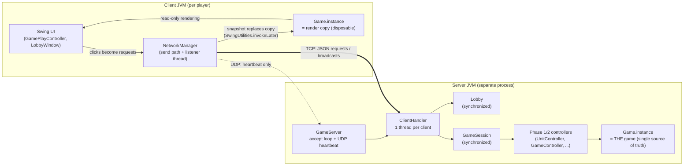
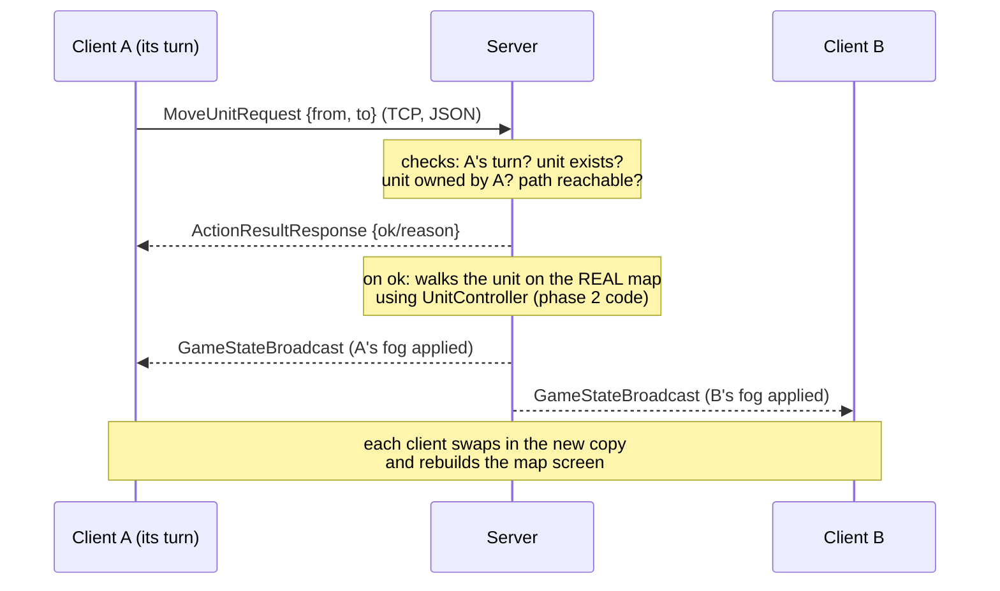

# Phase 3 — Multiplayer Architecture

This document records how the multiplayer conversion works and **why** each
decision was made, so any part of it can be explained (and defended) at the
evaluation.

## Big picture

- The **server owns the only real `Game`**. Clients keep a throwaway copy that
  is completely replaced every time the server pushes a snapshot.
- Clients never run game logic for a decision. A click becomes a typed JSON
  request; the server validates it with the *same controller code* that phase
  1/2 already tested, mutates the real game, and pushes fresh snapshots.

## One action, end to end

Turn flow: players rotate in join order. `EndTurnRequest` from the current
player passes the turn on; when the **last** player ends their turn the server
runs the full phase-2 world step (`nextGameTurn`: production, upkeep, seasons,
disasters, barbarians, bears, autosave) once, then it is player 1's turn again.

## Decision log (ADRs)

### 1. Server runs in its own process
"Host Game" spawns a second JVM (`GameServer.main`). Reason: all phase 1/2
logic goes through the `Game.instance` singleton. If the server lived inside
the host player's JVM, the authoritative game and the host's render copy would
fight over that one static field. A separate process gives the server its own
singleton for free, and matches the spec's "server is the single source of
truth" picture. Trade-off: slightly harder to launch (mitigated: the game
spawns and kills the process automatically).

### 2. State travels as a fog-filtered serialized snapshot
Every broadcast, the server deep-copies the game (serialize→deserialize — the
whole model is already `Serializable` since phase 2 save/load), recomputes
visibility for the *receiving* player only, **strips everything they must not
know** (units/buildings/ruins/resources on fogged tiles), then sends the copy
Base64-encoded inside a JSON `GameStateBroadcast`.

- Why not a pure-JSON DTO of the whole state? The model graph is cyclic
  (Nation↔Unit↔Land), Gson can't walk it, and a hand-written DTO layer for
  ~30 classes is exactly the 30-40% we chose to cut. All *commands and
  responses* are real typed JSON; only the state payload rides as a blob.
  This is the honest trade-off and costs some points on the "everything JSON"
  row — accepted consciously.
- Filtering happens **server-side** as the spec demands: a client's packet
  physically does not contain what its player can't see (checked by the
  Phase3Driver fog tests), instead of the UI just not drawing it.

### 3. Clients re-render by full scene rebuild
Applying a snapshot reuses the exact save/load path from phase 2
(`adoptWindowFrom`, rebuild distance caches, `changeScene(GAME_MENU)`). One
mechanism, already tested, instead of a parallel "patch the screen" system.
Trade-off: a rebuild per action is heavier than incremental updates — fine at
this map size (15×15).

### 4. Server-side validation = the existing controllers
The server maps each request onto phase 1/2 controller calls against the real
game (`UnitController.unitSetPath`, `GameController.nextGameTurn`, ...). All
AP/terrain/occupancy rules apply automatically, and their error strings become
the `ActionResultResponse` reason shown to the player unchanged.

### 5. TCP / UDP split
TCP: lobby, chat, every state-changing request and broadcast — they need
guaranteed ordered delivery. UDP: heartbeat/ping only (loss is harmless and
measured). Nothing that affects game state ever rides UDP, so correctness
never depends on it.

### 6. Three "pre-designed" maps = three fixed seeds
`Green Valley`, `Twin Rivers`, `Iron Ridge` are fixed seeds into the existing
map generator, plus symmetric spawn slots (corners of the 15×15 map) and the
phase-1 fairness helpers (guaranteed food/forest tiles, never walled in by
mountain ranges) applied around **every** spawn. Same name ⇒ byte-identical
terrain, which is what "pre-designed, selectable in lobby" needs; designing
maps tile-by-tile by hand adds nothing for the grade.

### 7. What we consciously skip (the ~30-40% budget)
Same policy as phase 2: tribes-, sea- and catapult-dependent rows stay out
unless time is left. In this phase the cut list currently is: WebSocket chat,
voice chat, JDBC database, JWT auth (all Bonus), plus PvP-items and multiple
town halls until the core loop is rock solid. The requirements sheet
(`AP-Project-Requirements-FA.xlsx`, sheet «فاز ۳») is the single source of
truth for what is done vs skipped.
